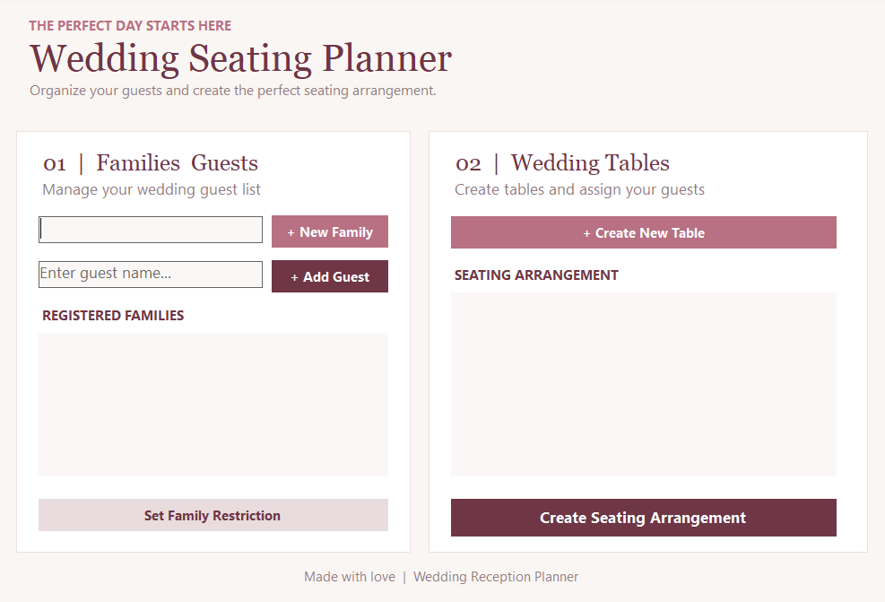

# 💗 Wedding Seating Planner

<p align="center">
  
  
  
</p>

<p align="center">
  <em>Because every beautiful wedding starts with a little organization. ♡</em>
</p>

## 🌷 About the Project

**Wedding Seating Planner** is a C# Windows Forms desktop application designed to simplify wedding guest management and seating arrangements.

Organizing a wedding reception involves more than creating a guest list. Families need to be grouped together, table capacities must be respected, and certain families may need to be seated separately.

The application provides an elegant, interactive interface for managing these requirements and automatically generating seating arrangements.

Developed as part of a **Software Design Patterns** university project, it demonstrates how object-oriented programming and three design patterns — **Composite, Strategy, and Iterator** — can be combined in a practical desktop application.

## 🎀 Features

| Feature                            | Description                                                       |
| ---------------------------------- | ----------------------------------------------------------------- |
| 💌 Family Management               | Create families and organize their members.                       |
| 👥 Guest Management                | Add individual guests to a selected family.                       |
| 🪑 Table Management                | Create wedding reception tables.                                  |
| ✨ Automatic Seating                | Generate seating arrangements using a dedicated seating strategy. |
| 🚫 Family Restrictions             | Select specific pairs of families that must not share a table.    |
| 💕 Seating Validation              | Respect table capacity and family compatibility rules.            |
| 🌸 Interactive Table Visualization | View tables as circular layouts with individual seats.            |
| 🎯 Table Selection                 | Click a table to see its assigned families and guests.            |
| 📊 Live Statistics                 | Display the current numbers of families, guests, and tables.      |
| 🎨 Romantic Interface              | Enjoy a soft pink, rose, and burgundy visual theme.               |

## 🖥️ Application Interface

The application features a wedding-inspired design with soft pink backgrounds, rose-colored buttons, elegant typography, and interactive seating diagrams.

The interface is organized into three main areas:

**Dashboard**

Displays live statistics for registered families, individual guests, and available tables.

**Families & Guests**

Allows users to create families, add guests, browse registered family members, and define seating restrictions between specific families.

**Wedding Tables**

Provides a visual overview of reception tables, including circular seating diagrams, occupied seats, table capacity, and assigned guests.

Users can select a table to inspect its seating details and generate a new seating arrangement using the application’s seating algorithm.

\<p align="center">
&#x20; \
\</p>

## 🧁 Technologies Used

- **C#** — Main programming language.
- **Windows Forms (WinForms)** — Desktop graphical user interface.
- **.NET** — Application framework.
- **Object-Oriented Programming** — Encapsulation, inheritance, abstraction, and polymorphism.
- **System.Drawing** — Custom graphical rendering of circular tables and seats.
- **LINQ** — Collection queries and data processing.
- **Design Patterns** — Composite, Strategy, and Iterator.

## 💎 Software Architecture

The project separates application entities, seating algorithms, collection traversal, and user interface responsibilities.

Three design patterns are implemented and organized into dedicated folders to make their roles easier to identify and understand.

### 💕 Composite Pattern

The **Composite Pattern** organizes individual guests and groups of guests through a shared abstraction.

The application uses `WeddingComponent` as a common base class for wedding-related entities.

| Class              | Role      | Responsibility                                     |
| ------------------ | --------- | -------------------------------------------------- |
| `WeddingComponent` | Component | Defines common operations for wedding entities.    |
| `Guest`            | Leaf      | Represents an individual wedding guest.            |
| `Family`           | Composite | Contains and manages individual guests.            |
| `Table`            | Composite | Contains and manages families assigned to a table. |

The pattern provides a consistent way to work with guests, families, and tables.

For example, `GetCount()` allows the application to calculate the number of guests represented by a component.

### ✨ Strategy Pattern

The **Strategy Pattern** separates the seating algorithm from the Windows Forms interface.

Instead of implementing seating logic directly inside `Form1`, the application delegates the process to a strategy.

| Class                       | Role               | Responsibility                                   |
| --------------------------- | ------------------ | ------------------------------------------------ |
| `ISeatingStrategy`          | Strategy Interface | Defines the contract for seating algorithms.     |
| `SequentialSeatingStrategy` | Concrete Strategy  | Implements automatic family-to-table assignment. |
| `Form1`                     | Client             | Selects and executes the seating strategy.       |

The seating algorithm considers several requirements:

- A table can accommodate a maximum of **10 guests**.
- A table can contain a maximum of **2 families**.
- Families marked as incompatible cannot share a table.
- Families are assigned together rather than split between tables.
- The algorithm searches for a valid arrangement and reports when the available tables cannot accommodate all families.

The separation makes it possible to introduce additional seating strategies without redesigning the user interface.

### 🌸 Iterator Pattern

The **Iterator Pattern** provides sequential access to collection elements without requiring the user interface to work directly with their internal storage.

The application uses `IEnumerable<T>` and `IEnumerator<T>` to traverse collections of guests and families.

| Class            | Responsibility                                          |
| ---------------- | ------------------------------------------------------- |
| `FamilyIterator` | Traverses the guests belonging to a family.             |
| `TableIterator`  | Traverses the families assigned to a table.             |
| `Family`         | Exposes guest iteration through `IEnumerable<Guest>`.   |
| `Table`          | Exposes family iteration through `IEnumerable<Family>`. |

This allows the application to use `foreach` when displaying family members or examining the families assigned to a table.

### 🎀 Why These Patterns?

Each design pattern addresses a different aspect of the application:

- **Composite** organizes guests, families, and tables into a hierarchical structure.
- **Strategy** separates the seating algorithm from the interface.
- **Iterator** provides consistent traversal of guest and family collections.

Together, they improve separation of responsibilities, maintainability, and extensibility.

## 📂 Project Structure

```text
WeddingSeatingApp/
│
├── DesignPatterns/
│   │
│   ├── Composite/
│   │   ├── WeddingComponent.cs
│   │   ├── Guest.cs
│   │   ├── Family.cs
│   │   └── Table.cs
│   │
│   ├── Strategy/
│   │   ├── ISeatingStrategy.cs
│   │   └── SequentialSeatingStrategy.cs
│   │
│   └── Iterator/
│       ├── FamilyIterator.cs
│       └── TableIterator.cs
│
├── Form1.cs
├── Form1.Designer.cs
├── Program.cs
└── img.png
```

## 💗 How It Works

1. **Create families** — Register the families attending the wedding.
2. **Add guests** — Select a family and add its individual members.
3. **Define restrictions** — Choose two families that should not sit together.
4. **Create tables** — Add the required number of reception tables.
5. **Generate seating** — Run the automatic seating algorithm.
6. **Explore the arrangement** — Click on a table to view its assigned families and guests.

The application checks seating constraints while assigning families and informs the user if a valid arrangement cannot be found.

## 🖥️ Getting Started

### Prerequisites

To run the application, you need:

- Windows 10 or Windows 11.
- Visual Studio with the **.NET desktop development** workload.
- A .NET SDK compatible with the project's configuration.

### Installation

**1. Clone the repository**

```bash
git clone https://github.com/desislavaTsocheva/SoftwarePatternsTU.git
```

**2. Open the project**

Navigate to the `WeddingSeatingApp` directory and open its solution or project file in Visual Studio.

**3. Build the application**

Use **Build → Build Solution**.

**4. Run the application**

Press `F5` or select **Start** in Visual Studio.

## 🌷 Future Improvements

The application can be extended with additional functionality:

- [ ] Custom table capacities.
- [ ] Drag-and-drop guest assignment.
- [ ] Additional seating algorithms.
- [ ] Guest search and filtering.
- [ ] Editing and removing guests and families.
- [ ] Removing existing seating restrictions.
- [ ] Saving and loading seating arrangements.
- [ ] Exporting seating plans to PDF.
- [ ] Custom reception floor plans.
- [ ] Manual adjustments after automatic seating.

## 🎓 Academic Purpose

This project was developed as part of the **Software Design Patterns** coursework at the Technical University.

Its primary objective is to demonstrate the practical application of object-oriented programming and established design patterns in a functional desktop application.

The project focuses on:

- Applying the Composite, Strategy, and Iterator patterns.
- Separating application logic from presentation logic.
- Organizing code into clearly defined responsibilities.
- Implementing collection traversal and hierarchical structures.
- Designing a user-friendly graphical interface.
- Solving a practical seating arrangement problem with configurable restrictions.

## 🎀 Author

**Desislava Tsocheva**

<p align="center">
  <a href="https://github.com/desislavaTsocheva">
    
  </a>
</p>

---

<p align="center">
  Made with ♡, C# and a little bit of pink magic.
  <br/>
  <em>Making wedding planning a little more beautiful, one table at a time. 🌷</em>
</p>
